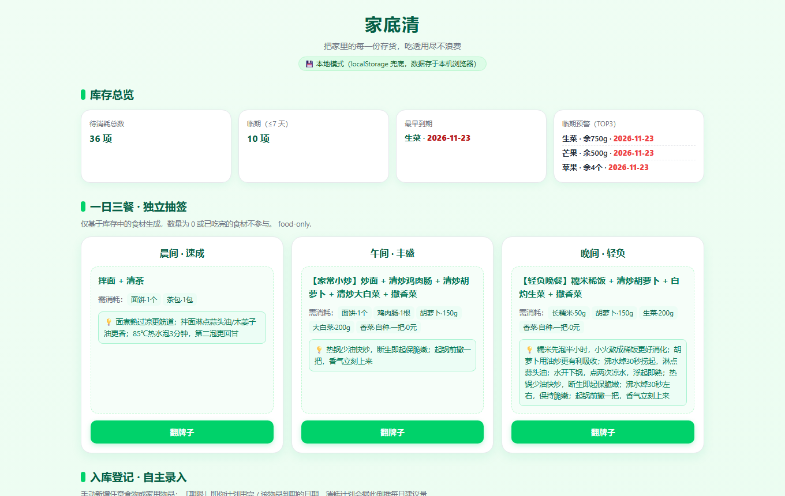
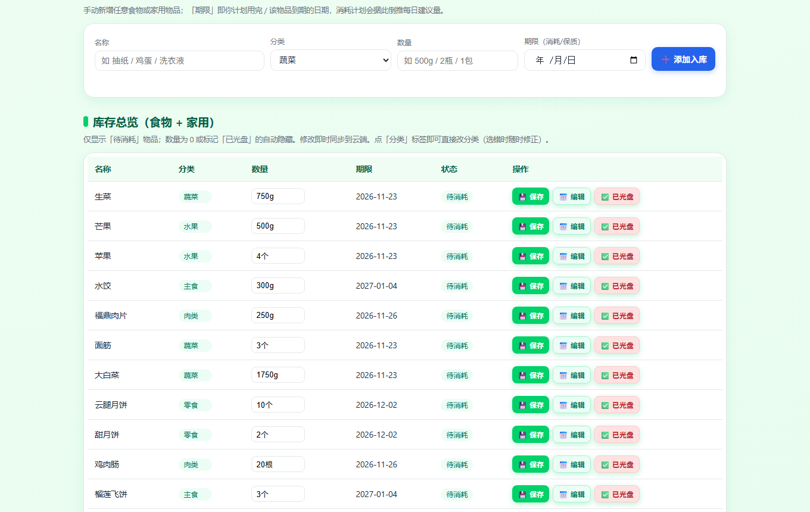
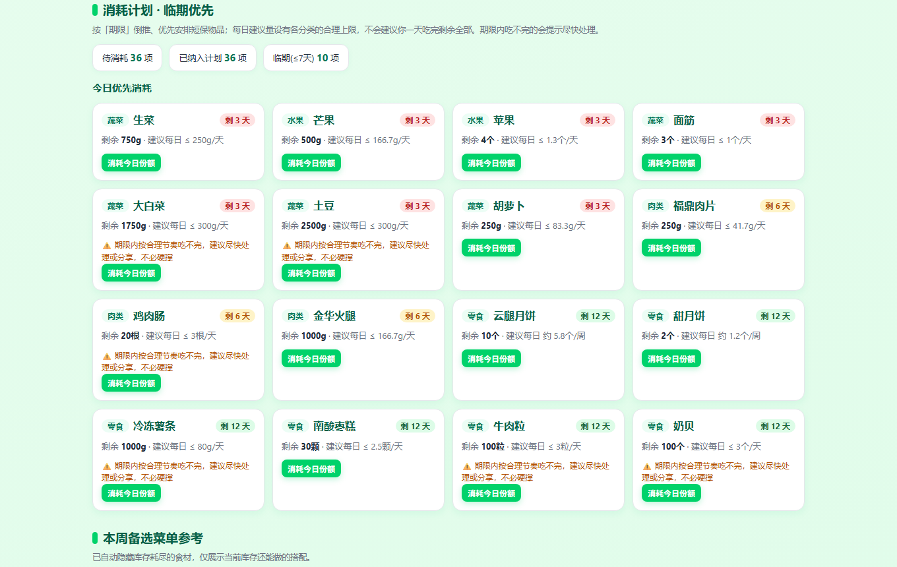

# ZeroWasteKit

**家里那一份库存，吃完用尽不浪费。**

我曾经有过这样的经历：冰箱里躺着一堆东西，记不清什么时候买的、还剩多少，最后一半烂在角落里、一半扔进垃圾桶——钱花了两遍，冰箱还塞不下。这个小工具就是从那时候开始做的。

ZeroWasteKit 帮你把家里吃的东西和用的东西都记下来，然后告诉你**今天该吃什么、哪些要赶紧吃掉**。

---

## 功能总览

| 功能 | 它到底帮你干什么 | 真实例子 |
|---|---|---|
| 库存总览 | 一眼看到家里还有多少东西、最早哪样要过期 | 36 项库存，10 项 7 天内到期，最早的生菜还剩 3 天 |
| 一日三餐抽签 | 点一下按钮，从现有库存里随机配出早中晚三餐 | 早餐「拌面 + 清茶」，午餐「【家常小炒】炒面 + 清炒鸡肉肠 + 清炒胡萝卜 + 清炒大白菜 + 撒香菜」 |
| 临期消耗计划 | 按保质期排出优先吃掉顺序，并算出每天该吃多少 | 大白菜剩 1750g，建议每天吃 300g；土豆剩 2500g，超过期限内能吃完的量，提示「不必硬撑」 |
| 每周备选菜单 | 给你 7 天的参考菜单，缺货的菜自动隐藏 | 家里没有生菜时，「白灼生菜」那道菜整道不出现 |
| 行内编辑 | 数量、分类、保质期直接点开就改，改完立刻存 | 点一下「蔬菜」标签就变成下拉框，改成「主食」即时保存 |
| 自种补给 | 记下阳台种的菜，可采收了自动进三餐 | 香菜标「可采收」，午餐自动加「撒香菜」，成本记 0 元 |
| 每周专款 | 记录每周买菜蛋奶的花费，看有没有超预算 | 本周预算 70 元，已花 15.4 元，还剩 54.6 元；本月 15.4 / 280 元 |
| 数量用文字写 | 不用纠结「克还是个」，想到怎么写就怎么写 | `750g`、`4个`、`1瓶`、`1包`、`半盘` 都能存 |
| 手机电脑都能开 | 页面自适应，手机浏览器直接打开就能用 | 390px 宽的手机屏幕上卡片自动排成一列 |

---

## 适用场景

**谁在用**

- 一个人住、经常点外卖，冰箱里东西零零碎碎的人
- 两个人过日子、想控制每周买菜开销的小家庭
- 喜欢囤货但总吃不完的「囤货型选手」
- 阳台种了香菜葱蒜、想把它算进日常饮食的人

**在什么环节用**

| 场景 | 什么时候打开 |
|---|---|
| 每天早上纠结「今天吃啥」 | 打开页面点三个「翻牌子」，直接出三餐 |
| 每周买菜前 | 看「本周剩余额度」，决定这周买什么、还差什么 |
| 周末整理冰箱 | 把新买的东西一条条录进去，顺手改掉旧数据的日期 |
| 发现东西快过期 | 看「今日优先消耗」，按建议量先吃临期的 |

---

## Demo 截图

<p align="center">
  
</p>

*点开三餐抽签后，直接给出能做的菜、消耗多少、怎么做。香菜是自己种的，显示「0 元」。*

<p align="center">
  
</p>

*库存表：数量、分类、期限都能直接点开改。鼠标停在哪一行，哪一行就变成薄荷绿。*

<p align="center">
  
</p>

*临期消耗计划：按剩余天数排序，每样都算好「建议每日吃多少」，超量的会提醒「不必硬撑」。*


---

## 快速开始

### Windows

双击 `run.bat`，会自动开服务并弹出浏览器。

### macOS / Linux

```bash
chmod +x run.sh
./run.sh
```

**然后**：浏览器打开 `http://localhost:8080` 就能用了。

> 首次打开自带 36 项示例数据，随便点、随便改都不会出事。想清空重来，浏览器里按 F12 → Application → Local Storage 清掉即可。

**手机也能开**：电脑和手机连同一个 WiFi，终端里会打印一行 `http://192.168.x.x:8080`，用手机浏览器打开这个地址。

**想要多设备同步**：见 [`examples/README-examples.md`](examples/README-examples.md) 第 6 节，建三张数据表把 ID 填进去就行。

---

## 文件清单

| 文件 | 作用 |
|---|---|
| `index.html` | 整个应用。样式、数据、三餐规则全在这一个文件里，双击就能跑 |
| `server.js` | 一个几十行的本地小服务器，作用是让你手机连电脑访问（没有它也能用，只是只能在这台电脑上打开） |
| `run.bat` | Windows 一键启动：起服务 + 开浏览器 |
| `run.sh` | macOS / Linux 一键启动 |
| `examples/README-examples.md` | 改菜、改额度、改分类、接数据表的全部示例代码 |
| `assets/*.png` | README 里用的界面截图 |
| `LICENSE` | MIT 许可证 |

---

## 技术栈

`Vanilla JS` · `单文件 HTML` · `无框架` · `无构建步骤` · `数据存浏览器或自带数据库`

---

---

# English version

## ZeroWasteKit

**Know what you have. Eat what you bought. Waste nothing.**

I used to stand in front of an open fridge with no idea what was inside — no clue when I'd bought it, how much was left, or whether it was still good. Half of it ended up in the bin, the other half blocked the shelves. I'd paid for the food twice and still didn't have room for the next shop.

ZeroWasteKit is the small tool I built to fix that. It tracks the food and household items you own, then tells you two things: **what to eat tonight, and what needs eating first.**

---

## Feature overview

| Feature | What it actually does | A real example |
|---|---|---|
| Inventory overview | See at a glance how much you have and what's expiring first | 36 items tracked, 10 expiring within 7 days, lettuce closest at 3 days left |
| Meal draw | One click spins up breakfast, lunch, and dinner from what you already have | Breakfast: "mixed noodles + plain tea"; lunch: "stir-fried noodles + stir-fried chicken sausage + stir-fried carrot + stir-fried cabbage + a scattering of coriander" |
| Expiry-first plan | Ranks what to eat next and works out a realistic daily amount | Napa cabbage, 1750g left — eat 300g a day; potatoes, 2500g left — more than you'll finish before it turns, so it says "no need to force it" |
| Weekly menu | Suggests a 7-day menu and hides any dish whose ingredients you've run out of | With no lettuce left, the "blanched lettuce" dish disappears entirely |
| Inline editing | Change quantity, category, or expiry date right in the table | Tap the "vegetables" tag, it turns into a dropdown, pick "staple food", it saves instantly |
| Home-grown produce | Track what you're growing on the balcony; harvestable items join the meal rotation | Coriander marked "ready to pick" gets added to lunch as "sprinkle with coriander", at zero cost |
| Weekly budget | Log what you spend on fresh produce, eggs and dairy, and see if you're over | Weekly cap 70, spent 15.4, 54.6 left; monthly 15.4 of 280 |
| Free-form quantities | Write quantities the way you'd say them | `750g`, `4个`, `1瓶`, `1包`, `半盘` all work |
| Works on phone and desktop | The layout adapts, so you can just open it on your phone | On a 390px-wide screen the cards stack into a single column |

---

## Where it fits

**Who it's for**

- People living alone who order out often and end up with a cluttered fridge
- Couples or small families trying to keep a lid on weekly grocery spending
- Bulk buyers who always end up with too much
- Anyone growing herbs on a balcony and wants them to count as part of the diet

**When to open it**

| Situation | When |
|---|---|
| Standing in the kitchen at 7am, nothing sounds good | Open it, hit the three draw buttons, dinner's decided |
| Before the weekly shop | Check your remaining weekly allowance, then decide what to buy |
| Tidying the fridge on a Sunday | Add new items one by one, fix dates on old ones while you're there |
| Spotted something about to turn | Check "eat these first" and work through the list at the suggested pace |

---

## Screenshots

<p align="center">
  
</p>

*After hitting the draw buttons, you get a dish you can actually cook, how much of each ingredient it uses, and a short method note. The coriander is home-grown, so it shows as costing 0.*

<p align="center">
  
</p>

*The inventory table: quantity, category, and expiry are all editable in place. Hover a row and it turns mint green.*

<p align="center">
  
</p>

*The consumption plan, sorted by days remaining, with a sensible daily amount worked out for each item. Anything you can't realistically finish in time gets a "no need to force it" note.*


---

## Quick start

### Windows

Double-click `run.bat`. It starts a local server and opens your browser.

### macOS / Linux

```bash
chmod +x run.sh
./run.sh
```

**Then** open `http://localhost:8080` in your browser and you're set.

> First launch comes with 36 sample items. Click and edit freely — nothing you do can break it. To reset, press F12 → Application → Local Storage and clear it out.

**On your phone too**: keep your computer and phone on the same WiFi, and the terminal will print a `http://192.168.x.x:8080` address. Open that on your phone.

**Want it on all your devices?** See section 6 of [`examples/README-examples.md`](examples/README-examples.md) — create three database tables, paste their IDs in, done.

---

## File listing

| File | What it's for |
|---|---|
| `index.html` | The whole app. Styles, data, and all the meal rules live in this one file — double-click and it runs |
| `server.js` | A tiny local server, so your phone can reach the computer. Not required; you just can't open it from another device without it |
| `run.bat` | One-click launcher for Windows: starts the server and opens the browser |
| `run.sh` | Same thing for macOS and Linux |
| `examples/README-examples.md` | Every example you'll need: adding dishes, changing the budget, new categories, connecting a database |
| `assets/*.png` | The screenshots used in this README |
| `LICENSE` | MIT licence |

---

## Tech stack

`Vanilla JS` · `single-file HTML` · `no framework` · `no build step` · `data lives in your browser or your own database`

---

## License

MIT — see [LICENSE](LICENSE).
